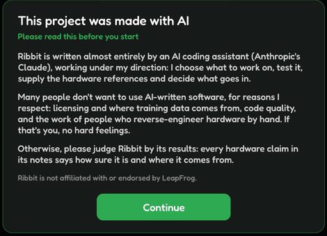

# Welcome to Ribbit

Ribbit is an emulator for LeapFrog's handhelds and TV consoles: the original Leapster (its main target), the Leapster L-MAX, Leapster TV and Leapster 2, the Zippity and the RockIt Twist. It runs on Windows, macOS, Linux and Android.

This guide is built into Ribbit (**Help › User Guide**). Choose a page on the left, or type in the search box to find every section that mentions a word.

## What you need

Ribbit comes with **no firmware and no games**. To play, you need:

- a dump of the **BIOS** (the system software) from your own Leapster, and
- dumps of your own **cartridges**.

For the other consoles you also need their own system files (see [Other consoles](#other-consoles)). Nothing else has to be installed: the download is the whole app.

## Made with AI

Ribbit is written almost entirely by an AI coding assistant (Anthropic's Claude), under the direction of its author, who chooses what to work on, tests it, supplies the hardware references and decides what goes in. Ribbit shows a short note about this the first time it starts.

Ribbit is not affiliated with or endorsed by LeapFrog Enterprises.

## The pages of this guide

- [Getting started](#getting-started): from the download to your first game.
- [The game library](#the-library): finding, choosing and starting games.
- [Playing](#playing): keys, controllers, touch controls and the console view.
- [Saves, save states and speed](#saves-and-save-states): keeping your progress, rewinding, fast-forwarding.
- [Picture and sound](#picture-and-sound): pixel-perfect, HD vectors, AI upscaling, sound effects.
- [Other consoles](#other-consoles): Leapster 2, L-MAX, Leapster TV, Zippity and RockIt Twist.
- [Ribbit on Android](#android): the side menu, the file picker, touch controls.
- [Updating Ribbit](#updating) and [When something goes wrong](#troubleshooting).
