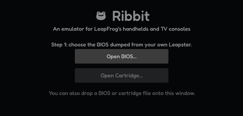

# Getting started

This page takes you from the download to your first game.

## Installing

There is nothing to install, and you don't need Rust or any other tool: the download is the finished app.

| System | Download | Then |
|---|---|---|
| Windows 10 or 11 | `Ribbit-…-windows-x64.zip` | Unzip it and run **Ribbit.exe** in the `Ribbit` folder. |
| macOS 11 or later | `Ribbit-…-macos-universal.zip` | Drag **Ribbit.app** to Applications. The first time, right-click it and choose **Open**. |
| Linux x86-64 | `Ribbit-…-linux-x64.tar.gz` | Unpack it and run `./ribbit`. |
| Android 8 or later | `Ribbit-…-android-arm64.apk` | Open it on the device and allow installing it. |

Downloads are on the [releases page](https://github.com/MotifMixes/ribbit/releases/latest).

## Your first game

1. Start Ribbit. The first time, it shows a note about how it was made; click **Continue**.
2. Click **Open BIOS…** and choose your BIOS dump. Ribbit remembers it.
3. Add your games folder: **File › Games Folders › Add Games Folder…**, or the **Add games folder** button in the library. Every game in the folder (plain or zipped dumps) appears with its title screen.
4. Click a game to play it.

> You can also drop a BIOS or cartridge file onto Ribbit's window, or open one game with **File › Open Cartridge…** (`Ctrl+O`).

## Which BIOS

The **US v2.1** BIOS (152-11265) works best. The **Universal v1.5** BIOS (155-10072) turns itself off after start-up unless you turn on **Emulation › Advanced (experimental) › MAME power-line workaround**.

Every BIOS you open stays in the library's BIOS list, together with any found in your games folders, so you can switch between them later. See [The game library](#the-library/the-console-and-the-bios).

## Where your things are kept

Settings, game saves, save states and screenshots go to Ribbit's data folder, not next to the program:

| System | Data folder |
|---|---|
| Windows | `%APPDATA%\Ribbit` (paste it into File Explorer's address bar) |
| macOS and Linux | `~/.config/ribbit` |
| Android | Ribbit's own app storage |

**Help › About Ribbit** shows the save folder. Updating Ribbit never touches this folder.
