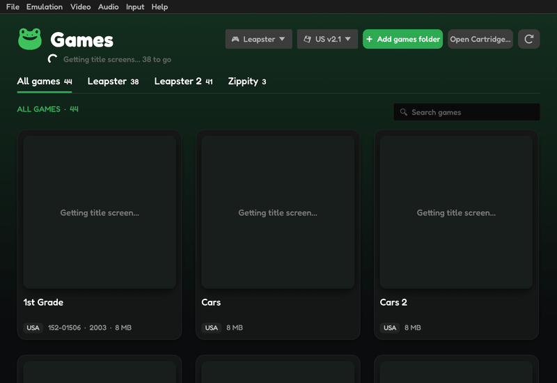

# The game library

Once a BIOS is chosen, Ribbit opens on your games: a card for each one, with its title screen.

## Finding games

- **Add games folder** (or **File › Games Folders › Add Games Folder…**) adds a folder; Ribbit looks in it and the folders inside it. Add as many as you like.
- **File › Games Folders** lists them; click one to stop looking in it.
- The **⟳** button looks for new games. On Android, pull the list down at the top and let go.
- Recent games show even without a folder: whatever you opened with **Open Cartridge…**.

While Ribbit works through new games, the line under the heading says how many title screens are still to come.

## Choosing and starting

- The tabs above the cards (**All games**, **Leapster**, **Zippity**…) show one console's games.
- Type in **Search games** to narrow the list by title.
- Click a card to play. The game you played last also shows large at the top.
- Right-click a card (long-press on Android) for more: **Delete save data…** removes that game's progress, profiles and save states, after asking. A copy goes to the `backups` folder first.

## The console and the BIOS

The two buttons at the top choose what your Leapster games play on:

- the **console** (Leapster, L-MAX, Leapster TV, Leapster 2): only consoles you have a BIOS for are offered;
- the **BIOS** for that console, when you have more than one (US, UK, Universal…). **Open another BIOS…** adds one.

A Leapster game plays on the console and BIOS chosen here, wherever you start it from.
