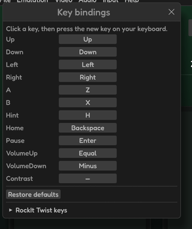
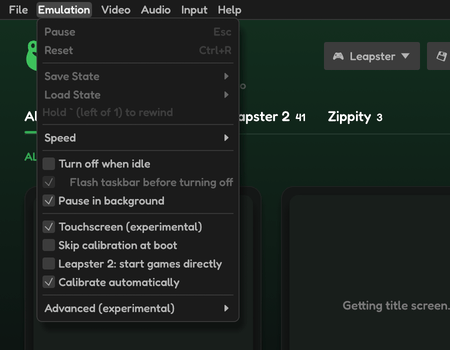

# Playing

## Keys

| Leapster | Key |
|---|---|
| D-pad | Arrow keys |
| A / B | `Z` / `X` |
| Hint | `H` |
| Pause (the Leapster's button) | `Enter` |
| Home | `Backspace` |
| Volume up / down | `=` / `-` |
| Stylus | Left mouse button, or touch |

| Ribbit | Key |
|---|---|
| Pause the emulation | `Esc` |
| Fast-forward | Hold `Tab` |
| Rewind | Hold `` ` `` (left of `1`) |
| Quick save / load state | `F5` / `F9` |
| Reset | `Ctrl+R` |
| Open cartridge | `Ctrl+O` |
| Console view on / off | `F7` |
| Show / hide the menu bar | `F10` |
| Fullscreen | `F11` |
| Screenshot | `F12` |

**Input › Key bindings…** changes the keys; **Help › Controls** (`F1`) lists them, with the Zippity's and the RockIt Twist's.

## Controllers

Plug in a game controller (XInput and others) and play:

| Leapster | Controller |
|---|---|
| D-pad | D-pad or left stick |
| A / B | A / B |
| Hint | X or Y |
| Pause | Start |
| Home | Back |
| Volume | LB / RB |
| Ribbit's menu | Guide |

## Touch controls

On a touchscreen (and always on Android), touching the screen shows an on-screen D-pad and buttons for the running console; several fingers work at once. They hide as soon as a key or controller button is used. **Input › Touch controls** turns them off.

## Pause, reset and the menus

- **Emulation › Pause** (`Esc`) stops the game; the same again goes on. **Pause in background** pauses it while another window is active.
- **Emulation › Reset** (`Ctrl+R`) restarts the console.
- **File › Close Cartridge** goes back to the library.
- **Turn off when idle** turns the console off after a while with nothing pressed, as the real one does (about 15 minutes; 5 on the Leapster TV). Before it does, a notice counts down the last minute.

## A game's own settings

Some games are best with their own settings: 2nd Grade, say, runs more smoothly with HD vectors on. While the game runs, tick **Emulation › Custom settings for this game**, then change what you like. The changes are for that game only (the Video, Audio and Input menus say "For this game only"): they come back each time it starts, and other games keep your usual settings. Untick it to give the game your usual settings again.

A game can have its own picture (Video menu), sound (Audio menu), speed, controls and start-up options. They are kept with your settings, by the cartridge's file name, so a game keeps them in another folder too. This works for Leapster, Leapster 2 and Leapster TV cartridges.

## The menu bar

Click a menu to open it; while one is open, point at another and it opens instead.

## The console view

**Video › Console view** (`F7`) shows the screen inside a drawing of the console, with its controls around it. Click, drag or scroll the controls to use them; with **Show keys on the console** each one shows its key and lights up while pressed.

## The stylus and calibration

Leapster games that use the stylus take the mouse (or a finger). **Emulation › Touchscreen (experimental)** must be on. When a game asks you to calibrate the screen, **Calibrate automatically** presses the targets for you; **Skip calibration at boot** uses the saved calibration instead.

## The debugger

The **Debug** menu has two tools for looking inside a running game. Each opens in a window of its own beside Ribbit's (inside it on Android); the game keeps running while you use them.

- **Memory viewer…** shows the console's memory sixteen bytes a line. Choose an area (RAM, VRAM, the BIOS, the cartridge…), type an address in **Go to**, or scroll. Click a byte and type two hex digits to change it; the arrow keys move along.
- **Debugger…** shows the CPU's registers and the code at the program counter. **Pause**, **Step** (one instruction) and **Continue**. Click a line of code to put a breakpoint on it (●) or take it off, or type an address in **Breakpoint at**; the game pauses when it gets there.

Pause, step and breakpoints work for the Leapster consoles and the LeapPad; the Zippity and RockIt Twist show their windows without them for now.
