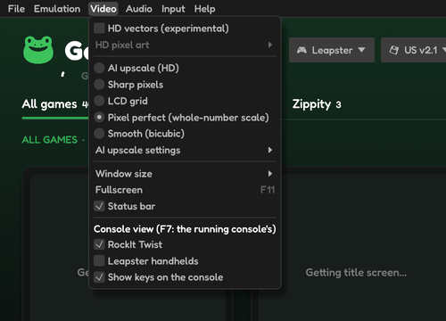
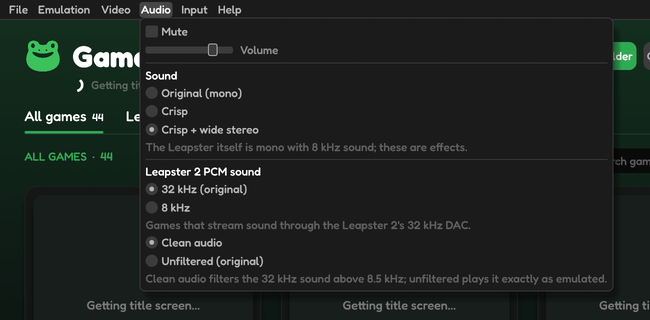

# Picture and sound

None of these change the emulation itself: only how the picture and the sound reach you.

## Picture

**Video** offers several ways to draw the Leapster's 160 × 160 screen:

| Choice | What you see |
|---|---|
| **Pixel perfect** | Sharp pixels at a whole-number scale (the default) |
| **Sharp pixels** | Sharp pixels filling the window |
| **LCD grid** | Pixels with the gaps of a real LCD between them |
| **Smooth (bicubic)** | Softened pixels |
| **AI upscale (HD)** | A neural network redraws the picture at up to 2560 × 2560 (**AI upscale settings** chooses the style and quality) |

**Window size** sets the window to a multiple of the screen, or **Fit screen**. **Fullscreen** is `F11`; **Status bar** shows or hides the line at the bottom.

## HD vectors (experimental)

Leapster games are Flash, so their artwork is stored as shapes, not pixels. With **Video › HD vectors**, Ribbit takes those original shapes from the console's own Flash player and draws them again at your window's full resolution: sharp edges, never AI-guessed. Bitmaps in the games show their own pixels (**HD pixel art › Traced into vectors** smooths them by a fixed algorithm instead).

HD vectors works on the original Leapster and L-MAX BIOSes. It is new; a game may show a shape wrongly.

## Sound

**Audio** has **Mute**, **Volume** and the sound itself:

- the Leapster is mono with 8 kHz sound; the default **Crisp + wide stereo** adds clarity and width, and **Original (mono)** plays it exactly as the console does;
- **Leapster 2 PCM sound** chooses how games that stream sound through the Leapster 2's 32 kHz output are played.

