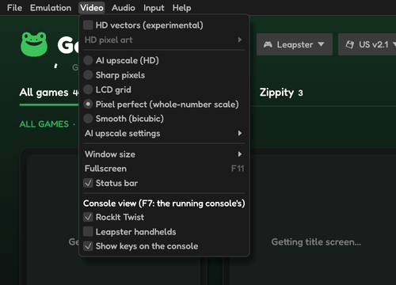
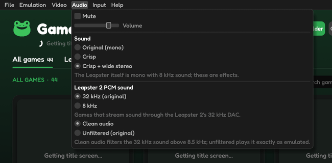

# Picture and sound

None of these change the emulation itself: only how the picture and the sound reach you.

## Picture

**Video** offers several ways to draw the Leapster's 160 × 160 screen:

| Choice | What you see |
|---|---|
| **Pixel perfect** | Sharp pixels at a whole-number scale (the default) |
| **Sharp pixels** | Sharp pixels filling the window |
| **LCD grid** | Pixels with the gaps of a real LCD between them |
| **Smooth (bicubic)** | Softened pixels |
| **AI upscale (HD)** | A neural network redraws the picture at up to 2560 × 2560 (**AI upscale settings** chooses the style and quality) |

**Window size** sets the window to a multiple of the screen, or **Fit screen**. **Fullscreen** is `F11`; **Status bar** shows or hides the line at the bottom.

## HD vectors (experimental)

Leapster games are Flash, so their artwork is stored as shapes, not pixels. With **Video › HD vectors**, Ribbit takes those original shapes from the console's own Flash player and draws them again at your window's full resolution: sharp edges, never AI-guessed. Bitmaps in the games show their own pixels (**HD pixel art › Traced into vectors** smooths them by a fixed algorithm instead).

HD vectors works on the original Leapster and L-MAX BIOSes. It is new; a game may show a shape wrongly.

## L-MAX TV (experimental)

The Leapster L-MAX has a TV output besides its own screen. With the TV output on, Ribbit shows both pictures: the TV's and the handheld's LCD. **Video › L-MAX TV mode** (`Ctrl+F6`) turns it on or off; off, the L-MAX plays as a handheld, its LCD alone. **Emulation › L-MAX TV output** holds the same choice with a third one, **Automatic** (the default): on with the v2.2 BIOS, off with the US v2.1 BIOS. The TV mode sets it to On or Off.

The L-MAX looks for a TV only when it starts, so changing the TV mode while an L-MAX game runs restarts the game (its saves are written first, as with **Reset**); a short message says so.

It is a guess at how the console behaves: how a real L-MAX notices the TV plug is not known, so Ribbit makes the console's TV chip answer instead. With the v2.2 BIOS both pictures show the game. With the US v2.1 BIOS, original Leapster cartridges send their picture to the TV only and leave the LCD blank, as v2.1 does with a TV plugged in.

**Video › L-MAX TV layout** (`F6` steps through them; `Shift+F6` swaps the TV and the LCD in any layout, as Cemu's swap does):

| Layout | What you see |
|---|---|
| **Stacked** | TV on top, LCD below (the default) |
| **Side by side** | TV on the left, LCD on the right |
| **Big TV, small LCD** | The TV picture, with the LCD small in the bottom-right corner (beside the picture when the window is wide enough) |
| **Big LCD, small TV** | The same the other way round |
| **TV only** / **LCD only** | One picture |
| **Separate windows** | The LCD in Ribbit's window, the TV picture in a window of its own (closing it leaves the LCD only). On Android: **Second display**, see below |

Ribbit remembers the layout. With a two-picture layout, the window sizes (**Video › Window size**, **Fit screen**) make room for both. Ribbit never opens a window full screen or maximised unless you ask.

**A second monitor.** With **Separate windows**, the same menu lists your connected monitors: choose the one the TV window goes on, or **Same as main window** (the TV window opens beside Ribbit's). **Full screen on that monitor** (off unless you turn it on) makes the TV window fill the chosen monitor. Ribbit remembers the choice; if that monitor is not connected when the TV window opens, the window opens beside Ribbit's instead.

The larger picture is drawn with your Video choice, AI upscale and HD vectors included (HD vectors follow the LCD, so they are off while the TV picture is the larger one). The other picture uses the same choice but sharp pixels instead of AI upscale. The stylus works on the LCD picture (on the TV picture when the LCD is not shown). The console view shows only with the LCD alone; screenshots and recordings show the main picture only.

**Android, dual-screen handhelds** (such as the AYN Thor): with **Second display**, the default there, the TV picture is on the main screen and the LCD on the second one, where the stylus works by touch. A phone with one screen shows the two stacked. This has not been tried on a dual-screen device yet; **Swap TV and LCD** changes which screen shows which if your device's screens are the other way round.

## Sound

**Audio** has **Mute**, **Volume** and the sound itself:

- the Leapster is mono with 8 kHz sound; the default **Crisp + wide stereo** adds clarity and width, and **Original (mono)** plays it exactly as the console does;
- **Leapster 2 PCM sound** chooses how games that stream sound through the Leapster 2's 32 kHz output are played.

