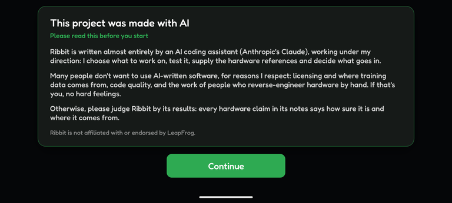
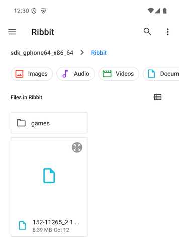
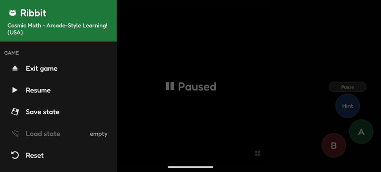
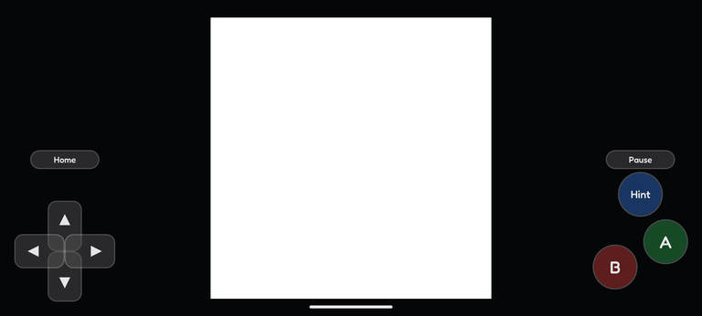

# Ribbit on Android

Ribbit on Android has the same emulation, laid out for a phone: no menu bar, a side menu instead, and Android's own file picker.

## The first start

The first time, Ribbit shows its note about AI on a page of its own; tap **Continue**. Then choose your BIOS and your games folder.

Ribbit asks once for **All files access** (Android's settings open); it needs it to read your dumps where they are.

## Choosing files

**Open BIOS…**, **Open Cartridge…** and **Add Games Folder…** open Android's own file picker. Choose a file, or for a folder, open it and tap **Use this folder**, then **Allow**. Files on the phone and its SD card are read where they are; a file from elsewhere (a cloud drive) is copied into Ribbit's storage first.

## The side menu

Swipe in from the left edge of the screen, or press **Back**, to open the side menu; tap outside it, swipe it back or press **Back** to close it. The game waits while the menu is open.

- **Exit game** goes back to your games. It asks first whether to make a save state, so you can carry on from there later.
- **Pause / Resume**, **Save state**, **Load state**, **Reset** and **Screenshot** act on the running game.
- **Speed**: normal, double, four times or as fast as possible.
- **Touch controls** turns the on-screen buttons on or off.
- **All settings** has every menu of the desktop app.

## Touch controls

The on-screen D-pad and buttons appear when you touch the screen and hide when a controller is used. Use several fingers at once. The stylus is the screen itself: touch the game's picture.

## The library on a phone

The library scrolls as a whole, header included. Pull it down at the top and let go to look for new games.
