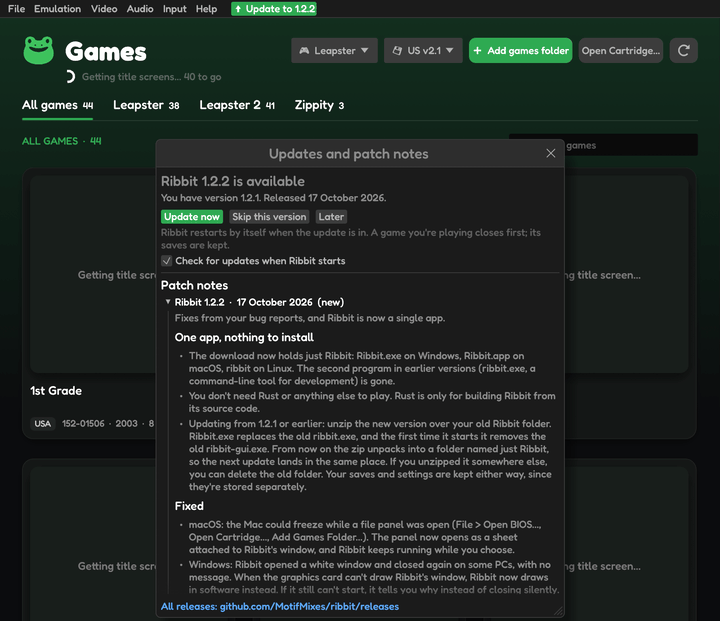

# Updating Ribbit

Ribbit checks for a new version when it starts (**Help › Check for updates…** checks now). When one is out, a green **⬆ Update to v1.2.3** button (with the new version's number) appears right after the menus.

1. Click the green button to see what's new.
2. Click **Update now**. Ribbit downloads the new version, puts it in place of the old one and restarts by itself. A game you're playing closes first; its saves are kept.

Your saves and settings stay where they are: they are not in the program's folder. **Skip this version** stops Ribbit announcing that version at start-up; **Later** keeps it for next time.

> **Update now** is offered from version 1.2.3 on, on Windows, macOS and Linux. On Android, and from older versions, the button says **Download** and opens the release page: download the file for your system, close Ribbit, and unzip the new version over your old `Ribbit` folder (on Android, install the new APK over the old one; don't uninstall first, which deletes the app's data).

## Patch notes

**Help › Patch notes** lists what every version brought, newest first.
